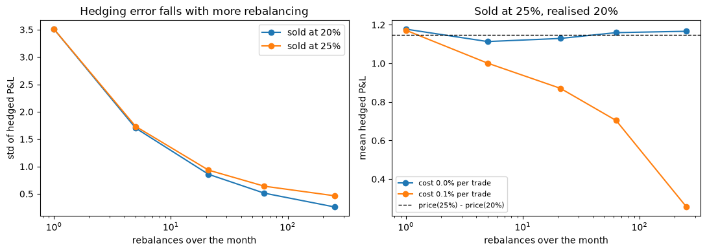
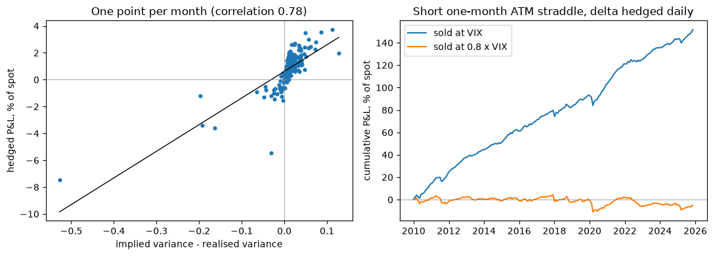

# Delta Hedging SPY Options

Sell an at-the-money straddle and delta hedge it with SPY shares. The P&L depends on implied versus realised volatility. The notebook checks this on simulated prices, then on real SPY data from 2010 to 2025.

## Method

- Black-Scholes price and delta (with dividend yield) for a one-month at-the-money straddle.
- Simulation: 5,000 price paths with 20% realised vol. The straddle is sold at 20% or 25% vol and hedged between 1 and 252 times a month. Costs are 0.1% per trade in one run.
- Real data: every 21 trading days, sell a 21-day ATM straddle on SPY and hedge it daily (191 non-overlapping trades). Implied vol from VIX, rate from the 13-week T-bill, actual dividends, 1 bp per share trade.

## Results



- Sold at the true vol, the hedged P&L averages zero. Its standard deviation falls from 3.51 (hedged once) to 0.26 (252 rebalances).
- Sold at 25% with 20% realised, the seller keeps about 1.15 at every hedging frequency.
- With 0.1% costs, 252 rebalances eat most of that edge.



| | Sold at VIX | Sold at 0.8 x VIX |
|---|---|---|
| Mean P&L per trade | +0.79% of spot | -0.03% of spot |
| Winning trades | 83% | 62% |
| Worst trade | -7.5% (March 2020) | -8.2% (March 2020) |

- Trade P&L follows implied minus realised variance (correlation 0.78).
- VIX averaged 18.4% against 14.5% realised volatility. With 0.8 x VIX as the ATM vol, the average profit disappears.

## Data

SPY, ^VIX, ^IRX and SPY dividends from Yahoo Finance, read with `yfinance`. No historical option prices are used: implied vol is approximated from VIX.

## Run it

```bash
pip install -r requirements.txt
jupyter notebook delta_hedging.ipynb
```
